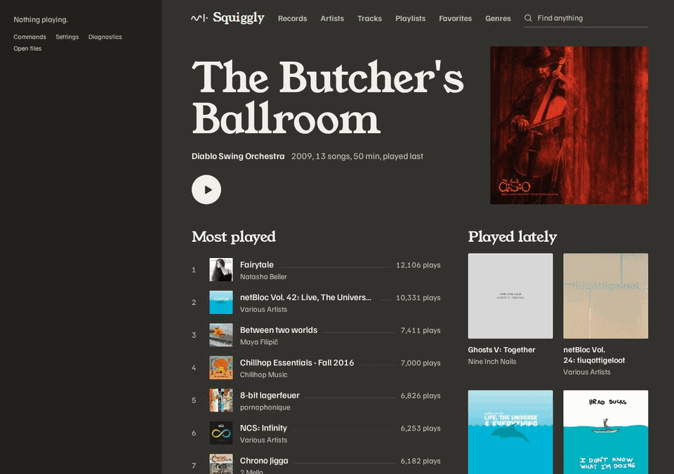
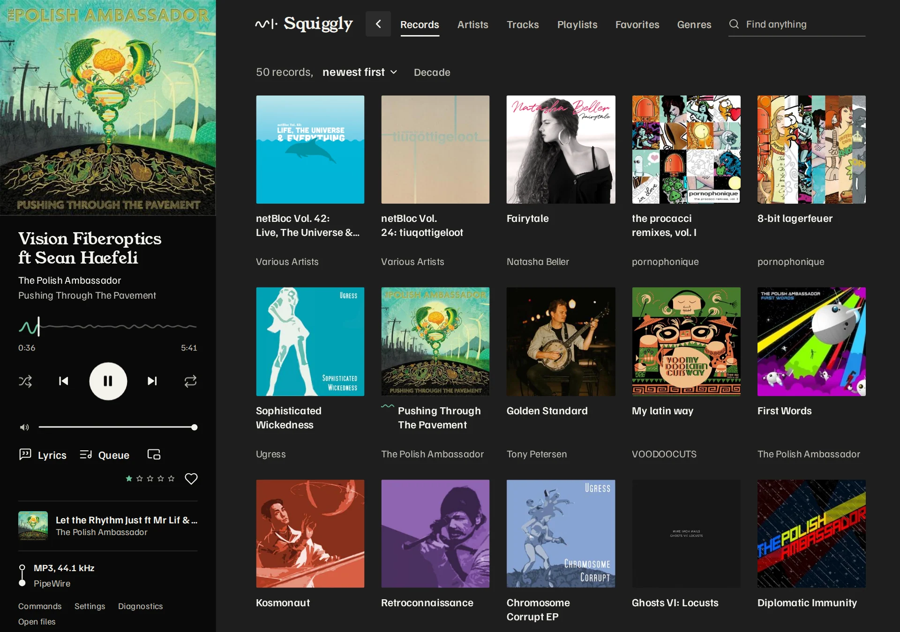
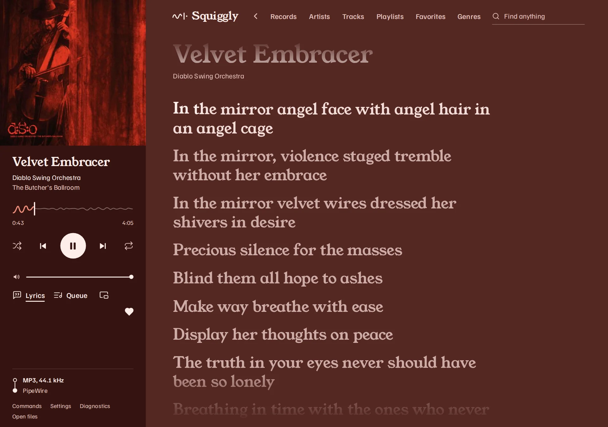
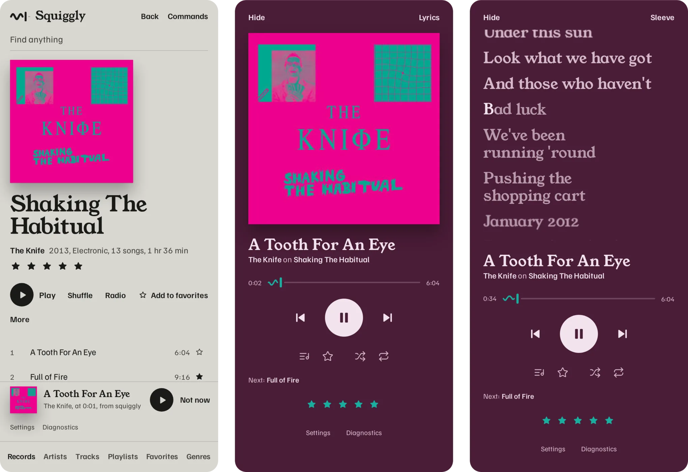

<h1>
  <picture>
    <source media="(prefers-color-scheme: dark)" srcset="docs/brand/wordmark-dark.png">
    
  </picture>
</h1>

Squiggly plays your own music from Navidrome. It asks the server for the original files, plays them through libmpv, and tells you what it knows about the signal path and what it can't know. The window takes its colours from the record that's playing.

It's early software. Windows, Linux, Android, and a browser version that works on phones. There's a macOS build too, untested on a real Mac. Website: [squiggly.psthl.com](https://squiggly.psthl.com).



## What's different

- No EQ, crossfade, or loudness levelling. It plays the original file and says when something changes it: volume below 100%, a sink that resamples, Windows refusing exclusive mode.
- Lyrics fill in word by word, on the lyrics page, in the deck, and in the mini player.
- Everything is on the keyboard. Ctrl+K finds any action, and `keybindings.json`, themes, and TypeScript extensions in the config folder reload when you save.
- Keep records and playlists on a desktop or phone, and they play from disk even when the server is up.
- The Android app is built for the Galaxy Z Flip, with Flex Mode and its own cover-screen view.

The rest is in [docs/features.md](docs/features.md).







<sub>The recording and screenshots use [Navidrome's demo server](https://demo.navidrome.org), whose music its artists released under Creative Commons and other free licences. Lyrics come from LRCLIB.</sub>

## Install

Grab a build from [Releases](https://github.com/parth-thakre/squiggly-music/releases). [docs/installing.md](docs/installing.md) has the per-platform steps, checksums, sign-in, and updates.

To run from source, you need Node 22.16+ and libmpv:

```bash
npm ci && npm run dev
```

## Docs

- [Installing](docs/installing.md)
- [Features](docs/features.md)
- [Browser version](docs/web.md): self-hosting, and reaching it from your phone
- [Signal path](docs/audio.md): what the readout can and can't tell you
- [Extensions](docs/extensions.md)
- [Android](docs/android.md): building, signing, and the Flip
- [Contributing](docs/CONTRIBUTING.md): dev setup, tests, and the rest of the internals docs

## License

[MIT](LICENSE). The installers include other people's software under their own licenses, listed in [THIRD-PARTY-NOTICES.md](THIRD-PARTY-NOTICES.md).
